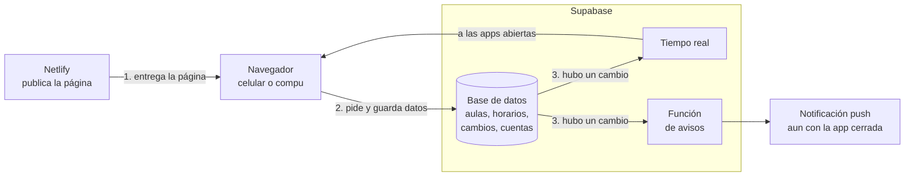

# Taiko

Integrantes: Fernandez, Juan Carlos, Gomez, Matias, Masino, Carlos Nicolas, Becerra, Diego. 
El equipo quedo conformado por unicamente 4 personas, no hay quinto integrante.

Producto: Producto software para agilizar la identificación y disponibilidad de aulas y diferentes instalaciones dentro de la UNLaM.

Segmento de la comunidad UNLaM: Estudiantes ingresantes y primer y segundo año de la carrera de grado.

# UNLaM WayFinder · Terminal del Campus

Web para encontrar tu aula en el Predio Central de la UNLaM (San Justo) y **enterarte a tiempo si te la cambiaron**.
Junta en un solo lugar lo que hoy está repartido: el mapa del campus, los horarios y comisiones del SIU, los cambios de aula
en vivo, los horarios de los servicios (biblioteca, comedor, enfermería…), las fechas del calendario académico y el
transporte cercano.

> **Proyecto independiente, hecho por estudiantes** (equipo TAIKO, Gestión Aplicada al Desarrollo de Software II, UNLaM,
> 2.º cuatrimestre 2026). **No es una herramienta oficial de la UNLaM.**

---

## 1. Qué es el producto

**El problema.** Cuando a un estudiante le cambian el aula, se entera tarde o por WhatsApp, y en un campus que no conoce
pierde de 5 a 15 minutos buscándola. **La información existe**, pero está repartida: los horarios en el SIU, el mapa en otra
página, los servicios en la página de cada departamento y los cambios en carteles o grupos.

**Para quién.** Ingresantes y estudiantes de 1.º y 2.º año que todavía no conocen el campus. El escenario de diseño es un
estudiante caminando por el campus, con el celular en la mano y llegando tarde. 
- Plataforma objetivo: **Android con Chrome** (en iPhone anda todo menos el aviso push con la app cerrada).

**Qué hace.**

| Para | Funcionalidad |
|---|---|
| Estudiante (sin cuenta) | Mapa del campus en tres niveles (campus → edificio → aula) y buscador de aulas, materias, comisiones, laboratorios, espacios y servicios · ocupación por día y turno, aviso de cambio de aula que no se cierra solo, **seguir una materia** y recibir un **push** si cambia de aula, aun con la app cerrada, ruta hasta el aula (campus, edificio y pisos; con GPS en el celular), calendario académico con recordatorios, paradas de colectivo y trenes cercanos, compartir un aula con día y turno, modo claro y oscuro |
| Estudiante (con cuenta, opcional) | Lo mismo, sincronizado entre dispositivos (materias seguidas, lugares guardados, configuración, fechas con aviso) |
| Docente (portal) | Pedir un cambio de aula para una clase o un aula para un día (parcial, final, consulta…) y seguir sus pedidos. Lo habilita un administrativo |
| Administrativo (portal) | Aprobar o rechazar pedidos, cargar cambios de aula con vigencia (un día, un rango o hasta fin del cuatrimestre), corregir el horario base, habilitar docentes y editar el calendario |

**Qué no es.** No reemplaza al SIU ni a Intraconsulta, y no detecta cambios por su cuenta: **muestra los que carga un
administrativo**. Los horarios salen del portal público del SIU (extraídos una sola vez, en agosto de 2026).
**La asignación aula ↔ comisión es de ejemplo**, porque el SIU público dice "Aula a determinar" en todas las comisiones.
Las cuentas y el legajo están **simulados** (no hay vínculo con SIU-Guaraní).

**De dónde viene.** En el TP5 probamos un MVP en el campus con 3 estudiantes: los 3 llegaron al aula en menos de 5 minutos
y supieron el aula nueva en menos de 1 minuto, así que decidimos perseverar. El producto final parte de ese MVP y suma lo
que salió de la prueba y de la auditoría técnica (TP6): aviso fijo y push, cuenta opcional, portal, calendario, transporte
y ruta hasta el aula. La evidencia de la prueba está en `docs/evidencia/`.

---

## 2. Cómo está armado

| En la página (anda siempre) | En Supabase (necesita conexión) |
|---|---|
| Mapa y planos de los edificios | Ocupación de aulas y horarios |
| Servicios y sus horarios | Cambios de aula y su historial |
| Paradas de colectivo y trenes | Cuentas, materias seguidas y pedidos del portal |
| Cálculo de la ruta hasta el aula | Envío de los avisos push |

- **Sin servidor propio.** La página habla directo con Supabase. La seguridad está en las reglas de la base (quién puede
  leer o escribir cada fila), no en esconder la clave.
- **Si Supabase no responde**, lo de la columna izquierda sigue andando y las aulas dicen "Sin datos" (nunca "Libre", para
  no mandar a nadie a un aula ocupada).
- **Los avisos (paso 3)** salen cuando un administrativo publica un cambio en el portal. El push le llega solo a quien sigue
  esa **materia + comisión**.

---

## 3. Cómo se ejecuta

- **Para usarlo:** está publicado en Netlify. Se abre desde el navegador del celular o de la compu, sin instalar nada (en
  Android se puede instalar como app). No hace falta cuenta.
- **Portal de docentes y administrativos:** la misma página con `?portal` (o `/portal`).
- **No requiere instalación ni compilación:** es un sitio estático conectado a Supabase.

---

## 4. Cómo se continúa

**Reglas que conviene respetar.**

- Los planos del campus no se redibujan: son los planos reales y lo único que no se puede regenerar.
- No inventar datos: si un dato no está, la app lo dice ("Sin datos") en vez de suponerlo.

**Lo que queda por hacer.**

- **Datos reales.** La asignación aula ↔ comisión es de ejemplo y los horarios son de agosto de 2026. Una versión en uso
  necesita acceso al SIU-Guaraní, y que las cuentas se identifiquen con él.
- **Avisos en vivo a escala.** Hoy cada cambio hace que todas las apps abiertas vuelvan a bajar toda la ocupación. Antes de
  abrirlo a mucha gente hay que mandar solo lo que cambió.
- **Quién lo sostiene.** Cargar los cambios de aula (Bedelía, departamentos), actualizar los datos cada cuatrimestre y
  manejar las cuentas del servicio. Falta un manual para administrativos.

---

## 5. Fuentes y licencias

- Horarios y comisiones: portal público del SIU.
- Calendario académico: `https://www.unlam.edu.ar/inicio/calendario-academico/`.
- Paradas y líneas de colectivo: © colaboradores de OpenStreetMap, licencia ODbL.
- supabase-js (la biblioteca que conecta la página con Supabase): licencia MIT, de código abierto".
- Tipografías: Google Fonts.
- Los planos del campus se basan en los planos de la UNLaM. El proyecto no usa escudos, sellos ni textos que sugieran
  un aval institucional.
